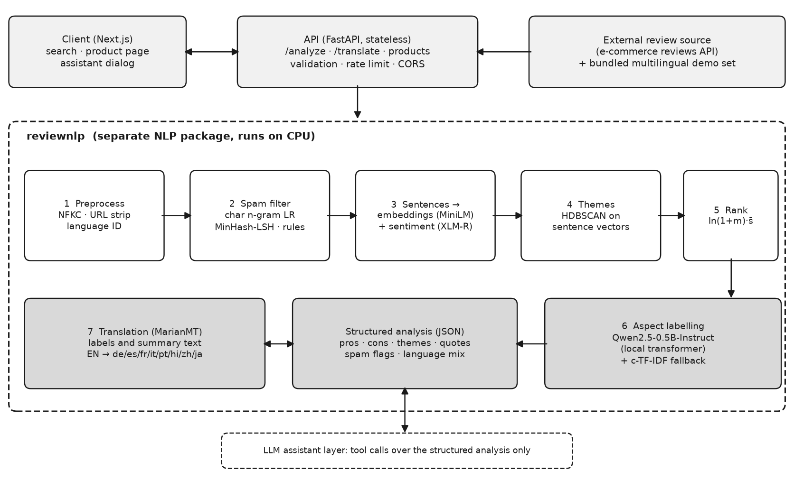

# ReviewLens

**Multilingual, spam-aware review intelligence for e-commerce.** Give it a product (or its reviews) and it returns ranked
**pros, cons and themes** with traceable quotes, a readable **summary** in the language you choose, and a **grounded chat
assistant** that explains the results. Reviews in any language are analysed together, suspected spam is removed first, and
nothing is stored.

> Project ID: CSEAIML2026-P14 · AI-Powered Multilingual E-Commerce Product Review Summarization Tool
> Paper: [`docs/ReviewLens_LNCS_Paper.pdf`](docs/ReviewLens_LNCS_Paper.pdf) (Springer LNCS format, 7 pages)

---

## Table of contents

1. [What it does](#what-it-does)
2. [Architecture](#architecture)
3. [Tech stack](#tech-stack)
4. [The NLP pipeline](#the-nlp-pipeline)
5. [Quick start](#quick-start)
6. [Configuration](#configuration)
7. [API reference](#api-reference)
8. [Evaluation](#evaluation)
9. [Project structure](#project-structure)
10. [Engineering practices, privacy and security](#engineering-practices-privacy-and-security)
11. [Troubleshooting](#troubleshooting)
12. [Limitations and roadmap](#limitations-and-roadmap)

---

## What it does

| Capability | How |
|---|---|
| **Aggregate and analyse many reviews** | Live search and paginated reviews through SerpAPI (Walmart engines), or a bundled multilingual demo set that needs no API key |
| **Pros, cons and recurring themes** | Sentence-level embeddings clustered with HDBSCAN, named by a small local transformer (Qwen2.5-0.5B-Instruct) with keyword fallback |
| **Sentiment-weighted ranking** | `score = ln(1 + mentions) × mean sentiment`, so themes that are both frequent and strongly felt rank first |
| **Multilingual reviews in one summary** | A multilingual sentence encoder puts all languages in one vector space; no translation is needed to group *"Der Akku hält ewig"* with *"the battery lasts all week"* |
| **Spam and fake-review filtering** | Three signals: a trained classifier, MinHash-LSH near-duplicate detection, and behavioural rules, each with a human-readable reason |
| **Summary in your language** | The summary and theme labels are translated on CPU with MarianMT; switching language never re-runs the analysis |
| **Grounded assistant** | A tool-calling LLM that may only answer from the structured results shown on the page, and declines everything else |
| **Concise summary next to the full list** | Summary card, theme chart, similar products, and the complete filterable review list with spam badges |

## Architecture



```
Browser  ──►  Next.js client (:3000)  ──►  FastAPI server (:8000)  ──►  reviewnlp package (CPU)
                  │                              │  products, reviews, validation,           preprocess · spam · embed ·
                  │                              │  rate limit, CORS, error handling         sentiment · cluster · rank ·
                  └─ /api/summary, /api/chat     └─ SerpAPI (reviews, 10 min in-memory cache) label · translate
                     (server-side routes, LLM tools over the analysis only)
```

- **`server/`** contains only web concerns. It calls one function, `reviewnlp.analyze(reviews)`.
- **`nlp/`** is a separate Python package with no web code: easy to test, reuse, or run from a notebook.
- **Stateless by design**: no database, no accounts, no stored reviews.

## Tech stack

| Layer | Technology |
|---|---|
| Client | Next.js (App Router), React, TypeScript, Tailwind CSS, Recharts, Vercel AI SDK |
| API | FastAPI, Pydantic, uvicorn, httpx |
| NLP | PyTorch, Hugging Face Transformers, sentence-transformers, scikit-learn, datasketch, lingua |
| Models | `paraphrase-multilingual-MiniLM-L12-v2`, `cardiffnlp/twitter-xlm-roberta-base-sentiment`, `Qwen/Qwen2.5-0.5B-Instruct`, MarianMT `opus-mt-en-*` |
| Tooling | uv (Python), pnpm (Node), Zod (schema validation) |

Everything runs on a laptop **CPU**; no GPU is required.

## The NLP pipeline

`reviewnlp.analyze(reviews, filter_spam=True, lang="en")`

| # | Stage | Method |
|---|---|---|
| 1 | Preprocess | Unicode NFKC, URL removal, language ID (lingua, 19 languages), sentence splitting for Latin and CJK |
| 2 | Spam filter | `max` of: character n-gram TF-IDF + logistic regression, MinHash-LSH near-duplicates (128 perms, J ≥ 0.8), author bursts (≥ 4 reviews), plus weak rule evidence (capitals, promo phrases, rating vs text mismatch). Flagged at score ≥ 0.7 |
| 3 | Encode | Multilingual MiniLM sentence embeddings (384-d) and XLM-R sentiment `s = P(pos) − P(neg)` per sentence |
| 4 | Themes | HDBSCAN (`min_cluster_size=4`) on non-spam sentences, k-means fallback, up to 8 themes with up to 4 quotes each |
| 5 | Rank | `score = ln(1 + m) · s̄`; pros have `s̄ > 0.15`, cons `s̄ < −0.15` |
| 6 | Label | Qwen2.5-0.5B-Instruct names each cluster (greedy decoding); cluster-level TF-IDF keywords as fallback; equal labels are merged |
| 7 | Translate | MarianMT for the displayed language (de, es, fr, it, pt, hi, zh, ja, ar, ru), cached client-side |

The pipeline output is typed JSON: pros, cons, themes with quotes and review ids, a language mix and a per-review
annotation (language, sentiment, spam score and reasons, theme membership). Every fallback is deterministic, so the
output is never empty if a model is unavailable.

**Assistant layer.** The chat assistant (`client/app/api/chat/route.ts`) is a tool-calling agent with five read-only tools
(`get_product_overview`, `get_pros_and_cons`, `get_theme_evidence`, `get_rating_and_sentiment_stats`, `get_spam_report`).
It never receives raw reviews, must call a tool before answering, declines off-topic requests, and treats review quotes as
data rather than instructions.

## Quick start

### Prerequisites

- **Python 3.12+** and [**uv**](https://docs.astral.sh/uv/)
- **Node.js 22+** and **pnpm**
- A [SerpAPI](https://serpapi.com) key (only for live product search; the demo product needs none)
- An LLM API key for the chat assistant and the written summary (optional; see [Configuration](#configuration))

### 1. Server and NLP package (first time only)

```bash
cd server
cp .env.example .env                              # add SERP_API_KEY
uv sync                                           # installs the API and the nlp package (torch CPU, transformers, ...)
uv run python ../nlp/scripts/train_spam.py        # ~1 min: trains the spam classifier into nlp/models/
uv run python scripts/make_demo_data.py           # regenerates the multilingual demo data (already in the repo)
```

### 2. Client (first time only)

```bash
cd client
pnpm install
cp .env.example .env.local                        # add your LLM key (see Configuration)
```

### 3. Run

One click on Windows: double-click **`start.bat`** (opens both servers and the browser). Or in two terminals:

```bash
cd server && uv run python server.py              # API    -> http://localhost:8000  (docs at /docs)
cd client && pnpm dev                             # client -> http://localhost:3000
```

Open <http://localhost:3000> and either search a product or click **Try the demo product**.

> **First run:** the first analysis downloads the models (about 2.5 GB in total, once) and then takes 30–40 s while they
> load. Later analyses of a product with ~100 reviews take about 10 s on a laptop CPU. Each translation language downloads
> a ~300 MB model on first use.
>
> **Restart the API** after changing `.env` or server code (auto-reload is unreliable on Windows).

## Configuration

### `server/.env`

| Variable | Default | Purpose |
|---|---|---|
| `SERP_API_KEY` | | Live product search and reviews. Stays server-side |
| `CORS_ORIGINS` | `http://localhost:3000` | Allowed browser origins (`localhost` and `127.0.0.1` on any port are always allowed) |
| `EMBED_MODEL` | `sentence-transformers/paraphrase-multilingual-MiniLM-L12-v2` | Sentence encoder |
| `SENTIMENT_MODEL` | `cardiffnlp/twitter-xlm-roberta-base-sentiment` | Sentiment model |
| `LLM_MODEL` | `Qwen/Qwen2.5-0.5B-Instruct` | Local model that names themes |
| `LLM_ENABLED` | `true` | `false` skips the local LLM and uses keyword labels |
| `LLM_BLURB` | `false` | `true` lets the local model paraphrase the basic summary |
| `DEVICE` | `auto` | `cpu` or `cuda` |
| `SPAM_THRESHOLD` | `0.7` | Spam decision threshold |

### `client/.env.local` (server-side only, never sent to the browser)

| Variable | Purpose |
|---|---|
| `GROQ_API_KEY` | Key for the hosted LLM behind the chat assistant and the written summary |
| `GROQ_MODEL` | Model id, default `openai/gpt-oss-120b` |
| `NEXT_PUBLIC_API_BASE_URL` | Optional, defaults to `http://localhost:8000` |

Without an LLM key the analysis, theme chart, spam filtering and review list all work; the summary falls back to the
basic template sentence and the chat button reports that the key is missing.

## API reference

Base URL `http://localhost:8000`. Interactive docs: `/docs`.

| Method | Path | Description |
|---|---|---|
| GET | `/health` | Liveness check |
| GET | `/api/products/search?q=` | Product search (SerpAPI Walmart) |
| GET | `/api/products/{id}/reviews?pages=3` | Reviews, 20 per page, 1–10 pages (1 SerpAPI credit per page) |
| GET | `/api/demo/reviews` | Bundled multilingual demo set with planted spam |
| POST | `/api/analyze` | Run the pipeline |
| POST | `/api/translate` | English to `de, es, fr, it, pt, hi, zh, ja, ar, ru` (MarianMT, CPU) |

```bash
# analyse the demo reviews
curl -s localhost:8000/api/demo/reviews > demo.json
curl -s -X POST localhost:8000/api/analyze -H "content-type: application/json" \
  -d "{\"reviews\": $(python -c "import json;print(json.dumps(json.load(open('demo.json'))['reviews']))"), \"filter_spam\": true}"
```

`/api/analyze` accepts `{reviews: [...]}` or `{product_id}` (max 2,000 reviews) plus `filter_spam`, and returns
`{pros, cons, themes, languages, total_reviews, analyzed_reviews, spam_removed, annotations, llm_used, blurb}`.

## Evaluation

All numbers are produced by [`nlp/scripts/evaluate.py`](nlp/scripts/evaluate.py) and saved to
[`docs/eval_results.json`](docs/eval_results.json). Re-run with `cd server && uv run python ../nlp/scripts/evaluate.py`.

**Spam classifier** on a held-out split of a public fake-review corpus (6,079 test reviews):

| Model | Accuracy | F1 | ROC-AUC |
|---|---|---|---|
| Majority class | 0.501 | 0.667 | 0.500 |
| Word TF-IDF + LR | 0.943 | 0.942 | 0.986 |
| Character n-gram TF-IDF + LR (deployed) | 0.926 | 0.926 | 0.978 |

The character n-gram model is kept because it does not need whitespace tokenisation (applies to Japanese, Chinese, Hindi).

**Spam signals** on the synthetic multilingual test set (94 reviews, 14 planted spam):

| Signals | Precision | Recall | F1 |
|---|---|---|---|
| Classifier only | 0.000 | 0.000 | 0.000 |
| MinHash-LSH + behavioural rules | 0.778 | 1.000 | 0.875 |
| All signals (deployed) | 0.737 | 1.000 | 0.848 |

The classifier targets machine-generated fakes, whereas the planted spam is templated and promotional, so the signals are
complementary rather than interchangeable.

**Sentiment** (balanced 200-review sample per language from the Multilingual Amazon Reviews test split):

| EN | DE | ES | FR | JA |
|---|---|---|---|---|
| 0.835 | 0.850 | 0.930 | 0.895 | 0.900 |

**Themes and labels** on the test set with 5 gold aspects: sentiment-sign accuracy 1.00; aspect coverage 0.60 (Qwen labels
with merging) versus 0.40 (keyword labels); label accuracy 0.40 versus 0.80. The small model merges clusters more
effectively but names them less precisely than keywords on this templated data.

**Latency** (94 reviews, laptop CPU, no GPU): 30 s first call including model load, 10 s afterwards.

## Project structure

```
R:\nlp
├── client/                     Next.js app
│   ├── app/                    pages: home (hero), search, product/[id], features, evaluation
│   │   └── api/                server routes: chat (assistant) and summary
│   ├── components/             Navbar, hero video, product workspace, summary card, theme chart,
│   │                           review list, assistant dialog, similar products, features, footer
│   └── lib/                    API client, schemas (Zod), shared types
├── server/                     FastAPI app (web concerns only)
│   ├── server.py               entry point
│   ├── app/                    routes, middleware, schemas, SerpAPI client, in-memory cache
│   ├── data/demo/              multilingual demo reviews with ground truth
│   └── scripts/                demo data generator
├── nlp/                        reviewnlp package (no web code)
│   ├── reviewnlp/              preprocess, spam, embed, sentiment, themes, llm, translate, pipeline
│   └── scripts/                train_spam.py, evaluate.py
├── docs/                       paper (docx and pdf), figures, eval_results.json
├── start.bat                   starts API and client on Windows
└── README.md
```

## Engineering practices, privacy and security

- **Privacy by design**: stateless, no database or accounts, reviews are processed in memory; the only state is a 10-minute
  cache of upstream responses. Author names are used transiently as a spam signal.
- **Separation of concerns**: the NLP package is independent of the web layer; schemas are validated at both ends (Pydantic, Zod).
- **Graceful degradation**: missing LLM, spam model or translation model never breaks a request; deterministic fallbacks apply.
- **Grounding**: generated text derives from ranked themes; the assistant can only read tool results, never raw reviews.
- **Robustness**: input limits (2,000 reviews per request), rate limiting (60 requests per minute per IP), CORS allow-list,
  request ids, uniform error handling; API keys live only in git-ignored env files and server-side routes.
- **Reproducibility**: locked dependencies, seeded splits, scripted training and evaluation that write JSON.

## Troubleshooting

| Problem | Fix |
|---|---|
| Analysis returns 503 or the summary spins forever | Check the API terminal; restart it after changing `.env` or code |
| "Can't reach the API" in the UI | Start the server (`uv run python server.py`) and check `NEXT_PUBLIC_API_BASE_URL` |
| Live search fails with 502 | Check `SERP_API_KEY` and your SerpAPI quota (each product opens 3 pages = 3 credits) |
| Old behaviour after a code change | Another old server may still hold port 8000 (Windows allows duplicate binds); stop all `server.py` processes and start one |
| First analysis very slow | Models are downloading and loading; subsequent runs are much faster |
| Chat says the key is not set | Add `GROQ_API_KEY` to `client/.env.local` and restart `pnpm dev` |
| Switching summary language shows English | The language's translation model downloads on first use; wait a moment |

## Limitations and roadmap

- Live reviews from Walmart are mostly English; multilingual behaviour is shown by the demo set and the benchmark.
- The spam classifier is trained on English machine-generated reviews; multilingual and human-written fakes are not yet evaluated.
- The 0.5B naming model is fast but sometimes assigns a neighbouring label; machine translation quality varies by language.
- The test set is synthetic; there is no human evaluation of summary quality yet.
- The `/evaluation` page expects a `docs/evaluation_results.json` file in an older schema, so it shows its upload prompt;
  the current measurements live in `docs/eval_results.json` and in the paper.

Planned: multilingual spam training data, a larger local naming model or constrained decoding, aspect-level sentiment,
and a human evaluation of summaries.
